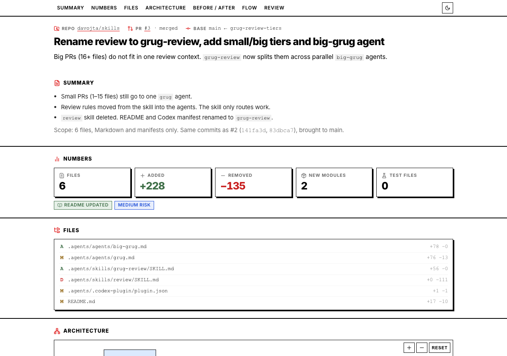
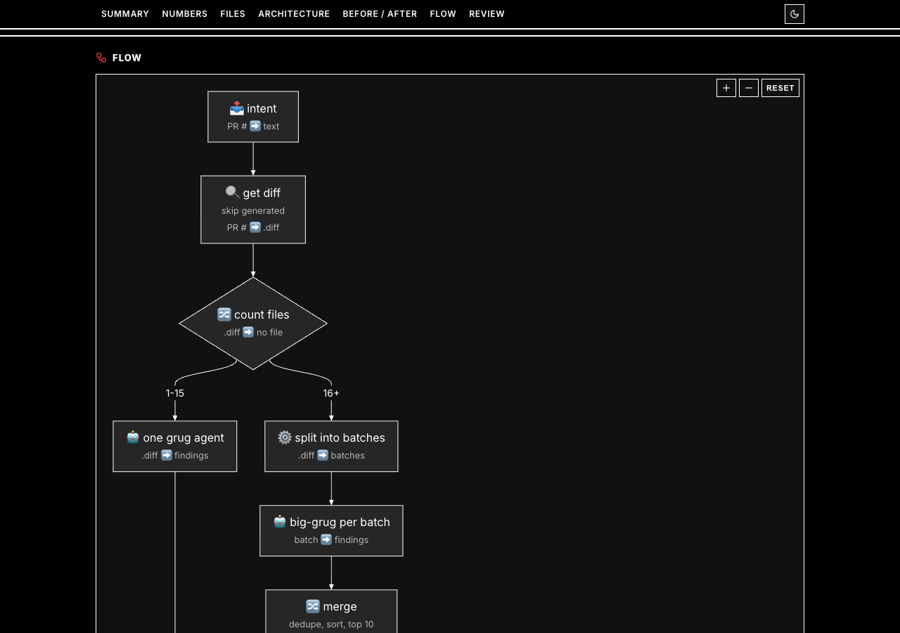

# Dzianis Sheka Skills

| Skill | Description |
| --- | --- |
| [`spec`](.agents/skills/spec/SKILL.md) | Size a change (simple / smol / medium / big) and write only the spec docs that fit it. |
| [`grug-review`](.agents/skills/grug-review/SKILL.md) | Review a diff for proven bugs and for code a tired developer cannot follow at 3 AM. Small diffs (1–15 files) go to one `grug` agent on opus; big ones go to parallel `grug` agents on sonnet, one per batch. Inspired by [`grug-review`](https://github.com/stepankuzmin/skills/blob/main/.agents/skills/grug-review/SKILL.md) and [The Grug Brained Developer](https://grugbrain.dev/). |
| [`visual-review`](.agents/skills/visual-review/SKILL.md) | One-page HTML overview of a PR with diagrams, before/after code, and a grug review. Adapted from [visual-explainer](https://github.com/nicobailon/visual-explainer) by Nico Bailon. |

Agent:

- `grug` gives a simplicity second opinion and reviews diffs for `grug-review`.

It rates findings with 12 pains (checked against *A Philosophy of Software Design* and *Tidy First?*), the Grug Scale, and a 0–10 grade.

## Sources

- [stepankuzmin/skills#7c3fa2c0275bcee7c1633a3ab6b0374e1a059b6e](https://github.com/stepankuzmin/skills/tree/7c3fa2c0275bcee7c1633a3ab6b0374e1a059b6e/.agents): repo layout, `cli.ts`, `grug` agent; `grug-review` adapts its `grug-review` skill
- Stepan Kuzmin's `grug` Claude Code plugin: the big-review batching flow
- [nicobailon/visual-explainer](https://github.com/nicobailon/visual-explainer): `visual-review` layout, Mermaid zoom, and section structure (MIT)

## Install

Claude Code and Codex install the whole `ds` plugin: `spec`, `grug-review`, `visual-review`, and the `grug` agent. Only the Skills CLI can install a single skill.

### spec only

Skills CLI:

```bash
npx skills add davojta/skills --skill spec
```

### grug-review and agents

Skills CLI (skill only, no agents; it reviews inline with its bundled `rules.md`):

```bash
npx skills add davojta/skills --skill grug-review
```

### visual-review only

Skills CLI:

```bash
npx skills add davojta/skills --skill visual-review
```

### Whole plugin

Claude Code, including the grug agent:

```bash
claude plugin marketplace add davojta/skills
claude plugin install ds@davojta
```

Codex:

```bash
codex plugin marketplace add davojta/skills
codex plugin add ds@davojta
```

### From a local clone

Pass the clone path instead of `davojta/skills`:

```console
❯ claude plugin marketplace add /Users/alex/projects/skills
✔ Successfully added marketplace: davojta (declared in user settings)

❯ claude plugin install ds@davojta
✔ Successfully installed plugin: ds@davojta (scope: user)
```

After editing a skill, refresh it:

```bash
claude plugin marketplace update davojta
claude plugin update ds@davojta
```

## Usage

### spec

```bash
/ds:spec path/to/task/input.md        # skill picks the tier
/ds:spec smol path/to/task/input.md   # force a tier: simple | smol | medium | big
/ds:spec Add retry to S3 downloader   # free text, no input file
```

With a free-form `input.md` kept outside the repo, force the `medium` tier:

```bash
/ds:spec medium /Users/alex/ai_tasks/ai-super-duper-web-service/2026-10-24-speedup-debug-tool-deployment/input.md
```

`proposal.md` and `design.md` go next to `input.md`. The skill stops after `proposal.md` to ask about open decisions.

With free text, docs go to `docs/tasks/<date>-<slug>/` if the repo already has `docs/tasks/`. If it does not, the skill asks whether to create that folder or use one you name.

### grug-review

```bash
/ds:grug-review                       # review the current diff; skill picks small or big
/ds:grug-review 42                    # review PR #42
/ds:grug-review big 42                # force parallel batches
```

### visual-review

```bash
/ds:visual-review                     # current branch vs main
/ds:visual-review 42                  # PR #42
/ds:visual-review HEAD                # uncommitted changes
```

Writes `~/.agent/diagrams/visual-review/<repo>/<pr-N or branch>/overview.html` and opens it.

Review of PR #3, light theme (summary, numbers, files) and dark theme (flow):




The page uses:

- Theme: tweakcn [DE-Swiss-Design](https://tweakcn.com/r/themes/cmluqysmw000204ji34jja0ul) on the [shadcn/ui](https://ui.shadcn.com) token structure
- Diagrams: [pele](https://github.com/obsidianmd/pele) 1.3.0 (MIT), which renders Mermaid syntax
- Icons: [Lucide](https://lucide.dev) via `lucide-static` 0.460.0 (ISC)
- Font: [Inter](https://fonts.google.com/specimen/Inter) (Google Fonts)

## Release

Bump the version in a PR. Merging it publishes the release.

```bash
npm version <patch|minor|major> --no-git-tag-version --ignore-scripts=false
```
